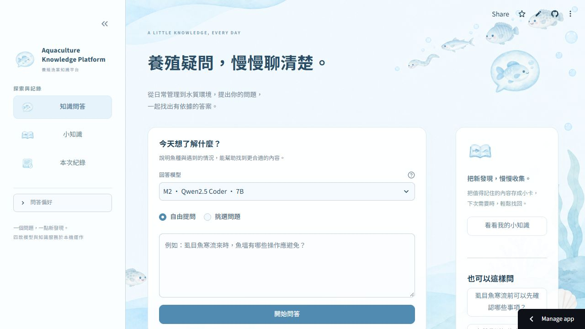
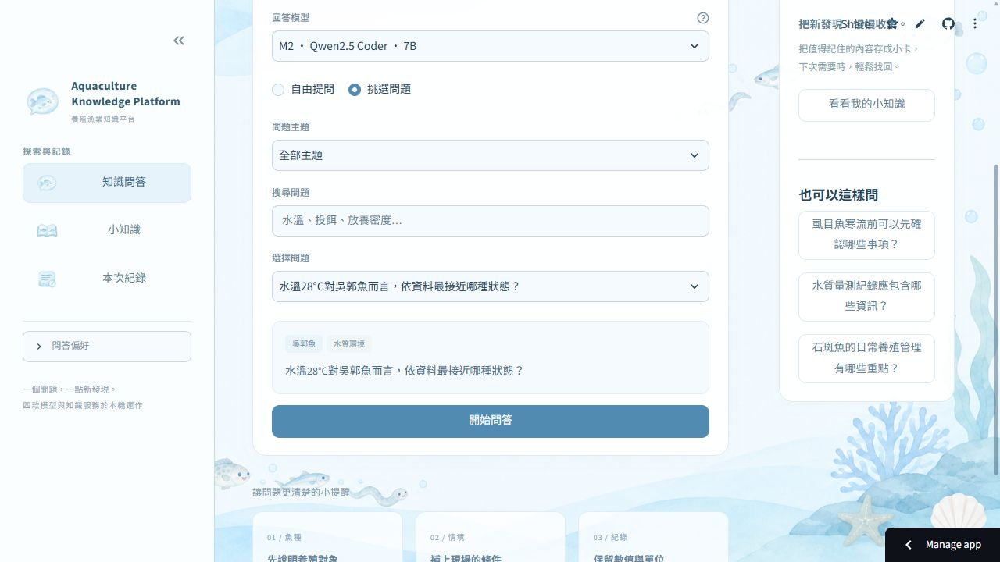
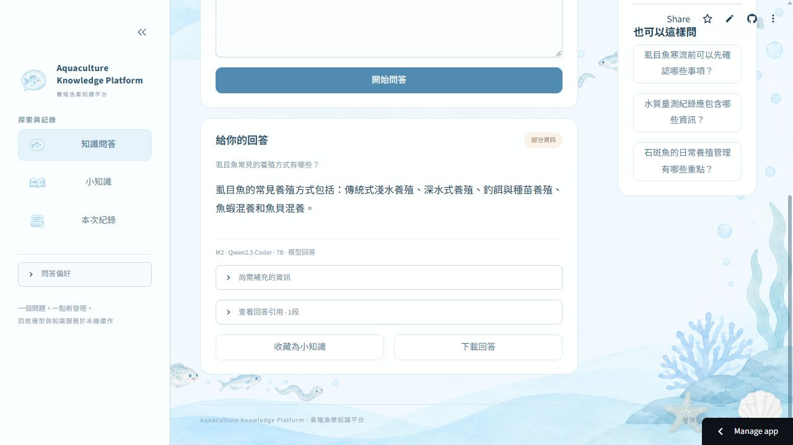
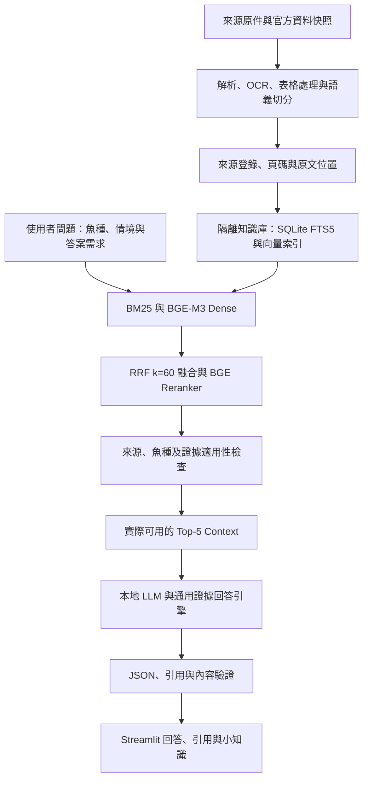

# Hybrid-RAG Aquaculture Knowledge Platform

## 養殖漁業知識平台

結合水產養殖資料、混合檢索與本地大型語言模型的繁體中文知識問答平台。使用者可以自由提問、切換四款模型、查看回答引用，並把值得記住的內容整理成小知識卡片。

專案聚焦臺灣常見的六類養殖魚：**虱目魚、吳郭魚、石斑魚、鱸魚、烏魚、鰻魚**，同時保留資料來源、適用條件、答案驗證與模型評測的追溯紀錄。

**[開啟網站](https://aquaculture-knowledge-platform.streamlit.app/)** · **[研究結果與模型比較](docs/research_results/README.md)** · **[專案檔案導覽](docs/PROJECT_LAYOUT.md)**

> 網站目前供持有工作區存取碼的研究使用者使用。README 與截圖更新於 **2026-11-23（臺灣時間）**；評測數字取自既有凍結結果，本次沒有重新執行模型評測。

導覽：[實際畫面](#網站實際畫面) · [平台功能](#平台可以做什麼) · [RAG 流程](#rag-架構與回答流程) · [模型](#模型與技術組成) · [知識庫](#現行知識庫規模與適用限制) · [評測](#四模型評測與部署選擇) · [執行方式](#本機執行與專案導覽)

## 網站實際畫面

以下圖片擷取自實際部署的 Streamlit 網站，展示目前的淡藍水彩介面。畫面只包含公開展示用的操作與示例，未包含登入資訊、私人筆記或問答歷史。

### 知識問答首頁

首頁可選擇回答模型、直接輸入問題，或從既有題庫開始探索。



### 題目瀏覽與篩選

使用者可以依主題搜尋既有問題，配合魚種偏好選擇問答情境。題庫共 180 筆，每類魚種各 30 筆。



### 真實模型問答示例

以下為本次操作網站取得的 M2 回覆。介面會標示回答狀態、模型與回答來源，並提供引用檢視入口。示例的「部分資訊」狀態保留，不能解讀為完整專業答案已獲保證。



## 平台可以做什麼

| 功能 | 說明 |
|---|---|
| 自由問答 | 直接描述魚種、養殖方式、現場條件與問題，查詢現有知識庫。 |
| 四模型切換 | 網站保留 M1–M4；預設 M2，可依需求切換。 |
| 題庫探索 | 瀏覽六魚種共 180 筆研究問題，依魚種、主題與文字篩選。 |
| 回答引用 | 查看通過檢查的原文片段、文件版本及可用的頁面定位；有可用圖像時顯示對應素材。 |
| 小知識卡片 | 收藏問答內容，或自行新增、編輯、搜尋與分類筆記。 |
| 問答紀錄與匯出 | 回看工作區既有問答，下載單次回答。 |
| 資訊缺口說明 | 證據不完整時呈現缺少的資訊；無合格依據時保留查核說明或拒答。 |

主要問題類別涵蓋養殖管理、水質環境、疾病防治、氣候防寒、用藥法規與養殖計算。各類別的來源與評測覆蓋仍有差異，平台功能支援不代表每一類問題都有充分答案。

### 使用方式

1. 開啟網站，使用研究工作區的既有存取方式進入。
2. 選擇模型；一般互動問答預設使用 M2。
3. 以自由提問或題庫模式輸入問題，盡量提供魚種、場域、時間與量測單位。
4. 閱讀回答狀態與引用內容，確認證據是否適用目前情況。
5. 將需要保留的內容收藏為小知識，或下載回答。

疾病、用藥與法規等高風險資訊仍應由適任專業人員依現況確認；本平台為研究與知識整理工具。

## RAG 架構與回答流程

系統以 **Hybrid Retrieval-Augmented Generation** 結合關鍵字與向量檢索，讓模型根據可追溯資料作答。



### 資料處理

- **來源治理**：分開保存研究准入、使用依據、版本、魚種適用性與檢索資格，保留原始文件雜湊及定位資訊。
- **文字清洗與語義切分**：依段落、章節及內容邊界處理文字，保存與原件的對應；掃描頁經 OCR 後保留品質狀態。
- **表格處理**：保存欄列、數值與單位；遇到缺值或複雜表頭時保留待複核資訊，不補造缺漏數據。
- **圖像處理**：建立圖像資產、頁面連結與圖像向量索引。圖像相似度只協助定位，不能當作疾病診斷或專家影像判讀。
- **檢索資格**：區分可作答案證據的內容與僅供背景的資料，保留各來源原有的使用限制。

### 檢索與生成

1. 從問題辨識魚種、情境與必要答案元素。
2. 使用 BM25 / SQLite FTS5 及 BGE-M3 Dense 取得候選。
3. 以 RRF（k=60）融合，再由 BGE Reranker v2-m3 重排序。
4. 檢查來源與魚種適用性，選出實際可用的 Context；不足五段時保留實際數量。
5. 將候選來源與答案證據充分性分開記錄；原文定位或相似度本身不會直接使答案合格。
6. 將證據交給本地模型，檢查結構化輸出與引用。必要時使用通用證據摘取，或呈現資訊缺口。

### 模型回答與系統回答分開記錄

| 回答來源 | 意義 |
|---|---|
| `MODEL_GENERATED` | 模型直接產生的回答，另記錄其驗證結果。 |
| `DETERMINISTIC_EVIDENCE_EXTRACTION` | 系統從符合條件的原文確定性摘取，保留支持位置。 |
| `ABSTAINED` | 證據不足而保留拒答或資訊缺口。 |
| `VALIDATION_FAILED` | 輸出未通過既定驗證。 |
| `SYSTEM_GUIDANCE` | 現行網站另存的查核／資訊缺口說明。 |

系統回補成功會獨立歸類，不會改寫模型原始回答，也不會將原始格式失敗改計為 JSON 通過。

## 模型與技術組成

| ID | 模型 | 本地模型標籤 | 量化 |
|---|---|---|---|
| M1 | DeepSeek-R1-Distill-Qwen-7B | `deepseek-r1:7b` | Q4_K_M |
| **M2** | **Qwen2.5-Coder-7B-Instruct（網站預設）** | `qwen2.5-coder:7b` | Q4_K_M |
| M3 | DeepSeek-R1-Distill-Llama-8B | `hf.co/bartowski/DeepSeek-R1-Distill-Llama-8B-GGUF:Q4_K_M` | Q4_K_M |
| M4 | Gemma2-9B-It | `gemma2:9b` | Q4_0 |

M3 依已核實的 **Llama 8B** 身分與 digest 使用；同名近似標籤不能自動替代。模型登錄與 digest 見 [現行 Corpus 與模型摘要](docs/research_results/corpus_status_summary.json)。

| 組成 | 採用方式 |
|---|---|
| 網頁介面 | Streamlit、淡藍水彩背景與原創魚類圖示 |
| 模型執行 | Ollama，本地四模型依序處理 |
| 文字向量 | BGE-M3 |
| 關鍵字索引 | SQLite FTS5 / BM25 |
| 融合與重排序 | RRF k=60、BAAI/bge-reranker-v2-m3 |
| 回答整合 | Grounded Answer Engine、結構與引用驗證 |
| 研究工具 | Python、pytest、JSON / JSONL 與 Excel 報表 |

### 部署方式

Streamlit Community Cloud 提供網站介面，本地研究服務負責知識庫、檢索與模型推論。雲端與本地服務透過經授權的 HTTPS 連線交換問答資料；**傳輸會經過雲端服務，並非所有處理皆完全離線**。

網站目前追蹤 GitHub **main**，入口為 `streamlit_cloud/streamlit_app.py`，雲端前端使用 Python 3.13。後端電腦與必要服務需持續運作；模型首次載入、切換或服務離線時，回應時間可能增加。

現階段是共用存取方式的單一研究工作區，問答紀錄與小知識由工作區成員共用，尚未提供個人帳號資料隔離。請避免輸入個資或機密資料。

## 現行知識庫規模與適用限制

現用版本為 **`marine-unified-v6-20261121_160441`**。Corpus v3 與其他歷史版本保留供研究追溯；根目錄舊入口與正式基線資料庫不是目前網站的作用中索引。

以下數字來自已保存的 Manifest，代表處理及索引規模，不代表所有內容均已獲專家核實：

| 項目 | 數量 |
|---|---:|
| 來源登錄 | 100 |
| 原始文件身分 | 98 |
| 文件頁面 | 1,278 |
| Chunk 總數 | 24,283 |
| Retrieval-eligible Chunk | 13,794 |
| Context-only Chunk | 10,489 |
| 圖像資產與圖像向量 | 6,637 |
| 表格元素 | 486 |

原件與衍生資料依官方法規、歷史法規、養殖技術、疾病、水質氣候、用藥、統計、圖片及表格整理在本機資料目錄。OCR、複雜表格、歷史版本與部分物種適用性仍保留複核狀態；「已解析」不能直接解讀為「每段都能安全回答」。

### 來源使用原則

- 研究負責人准入、開放資料授權與第三方著作權是不同狀態，分別記錄。
- 官方開放授權只適用已核實的實際資料資源，不延伸至外部網站、附件或其他第三方全文。
- 水試所問答保留原始 Record、日期及物種名稱；不同石斑魚或鱸魚的資料保留適用範圍。
- 動物用藥許可快照只支持原始欄位；資料完整性與現行有效性須另查，不能推導缺少的劑量、頻率或停藥期。
- 無可確認年度的鰻魚統計維持背景用途，不推定年度、趨勢或養殖管理建議。
- DGBAS 2020 仍限已核准的單年度描述性 Fact。
- 第三方文件、原圖、模型與向量庫依各自條款管理，不隨公開程式庫重新授權或散布。

## 四模型評測與部署選擇

現行 v6 已保存 **180 題 × 4 模型 = 720 筆最終生成**，該批次另保留含重試的 723 次原始嘗試。每模型皆為相同 180 題與同題固定 Context。題庫具有重複與近似知識群，屬探索性回歸，已參與系統調整。

### 11 項研究指標

下表引用 [現行聚合 JSON](docs/research_results/evaluation_metrics_summary.json) 的模型原始可用回答及來源 QA 後結果。各模型有效樣本可能不同，N 明列；共同題目的比較另見 [模型比較報告](docs/research_results/model_recommendation.md)。

| 指標 | M1 | M2 | M3 | M4 |
|---|---:|---:|---:|---:|
| Faithfulness | 0.9446（N=82） | 0.9095（N=112） | 0.7823（N=94） | 0.9085（N=119） |
| Judge Answer Relevance | 0.9502（N=82） | 0.9377（N=112） | 0.8145（N=94） | 0.9374（N=119） |
| BGE-M3 Cosine Similarity | 0.7278（N=83） | 0.6888（N=116） | 0.6478（N=95） | 0.7261（N=121） |
| Structured IFR：原始 JSON | 166/180（92.22%） | 179/180（99.44%） | 179/180（99.44%） | 180/180（100.00%） |
| TTFT（秒） | 7.6747（N=179） | 1.1077（N=180） | 1.2401（N=180） | 2.7842（N=180） |
| TPS（tokens/s） | 46.3809（N=180） | 43.1771（N=180） | 44.1616（N=180） | 9.2609（N=180） |
| System RAM（GiB） | 25.4573（N=180） | 25.6739（N=180） | 25.8730（N=180） | 26.2609（N=180） |
| Dedicated VRAM（GiB） | 5.9999（N=180） | 5.9787（N=180） | 6.5868（N=180） | 7.2188（N=180） |
| Logical Accuracy：可判定回答 | 13/19（68.42%） | 15/28（53.57%） | 17/22（77.27%） | 15/29（51.72%） |
| Arithmetic Accuracy：可判定回答 | 5/6（83.33%） | 4/11（36.36%） | 1/3（33.33%） | 9/11（81.82%） |

第 11 項 **Context Precision@5** 為四模型共用檢索指標：**0.35，有效 12 題／60 段**，採 AI-assisted 原文審查。不能外推全部 180 題，亦不形成四組模型各自的檢索分數。

### 固定題組分母

條件式 Accuracy 只計可判定回答；固定題組成功率則保留所有合格題，拒答、未完成與驗證失敗不會從分母消失。以下將內容符合與程式驗證分開呈現：

| 固定題組 | M1 | M2 | M3 | M4 |
|---|---:|---:|---:|---:|
| 50 題：來源內容符合 | 18/50（36.00%） | 19/50（38.00%） | 18/50（36.00%） | 24/50（48.00%） |
| 50 題：內容＋原始輸出驗證成功 | 7/50（14.00%） | 14/50（28.00%） | 15/50（30.00%） | 13/50（26.00%） |
| 37 題 Logical：來源內容符合 | 13/37（35.14%） | 15/37（40.54%） | 17/37（45.95%） | 15/37（40.54%） |
| 13 題 Arithmetic：來源內容符合 | 5/13（38.46%） | 4/13（30.77%） | 1/13（7.69%） | 9/13（69.23%） |

以上 50 題為**自動來源核驗子集**，含 37 題 Logical 與 13 題 Arithmetic，主要依賴 10 個來源群組、3 份原件。**Human Gold = 0**；來源群組衍生題目不能視為互相獨立的專家真值。

### 為什麼預設 M2

目前互動式網站採 **M2**，主要考量輸出格式穩定、互動延遲與現有 RTX 4060 8 GB 主機的部署效率。M4 在本輪固定 50 題來源內容符合率與 Arithmetic 內容符合率較高，但生成耗時與資源需求也較高；網站保留四模型供研究使用者切換。

另有使用者確認的「品質 70%／效能 30%」探索性選型整理，該方案推薦 M2。其正規化與資源代理含明列假設，不是答對率、原論文正式凍結總分、統計顯著性或專家認證。詳見 [加權方案與限制](docs/research_results/weighted_selection_report.md)；本次未新增權重或重算 Winner。

### 如何解讀數字

- Faithfulness 衡量回答與 Context 的支持關係，Judge Relevance 衡量問答相關性，兩者不能代替水產專業正確率。
- Judge 有效 N 可包含未通過引用閘、但仍有可讀正文的原始回答，因此不等於網站成功回答數。
- BGE-M3 Cosine 是文字向量相關程度，拒答文字相似度不能當成專業回答品質。
- Structured IFR 只衡量模型原始 JSON 格式；系統回補不會替模型增加格式通過數。
- TTFT 是請求至首個可見內容的時間；此批效能不包含預先凍結的檢索階段。TPS 使用各模型引擎的 token 與生成時間，受 tokenizer 和輸出內容影響。
- RAM／VRAM 是每次請求的**系統／設備層級採樣峰值平均**，不是模型程序專屬記憶體。Shared GPU Memory 缺乏可靠量測時維持 N/A。
- Logical／Arithmetic 只在具來源判準的子集計分；條件式準確率因分母不同，不能直接解讀成公平同題排名。
- 原始分數、來源 QA 修正與受程式閘影響的結果分開保留；複雜適用性、額外因果主張及少數 AI 判定仍待獨立專家確認。

## 本機執行與專案導覽

公開 repository 提供程式、介面素材、方法文件與可公開的聚合結果。原始文件、題庫、模型權重、向量索引與私人工作區資料留在本機；下載公開程式碼不會自動取得完整研究資料及已配置的模型服務。

### 啟動網頁前端

前端使用 Python 3.13 與獨立環境：

```powershell
python -m venv .venv-web
.\.venv-web\Scripts\python.exe -m pip install -r streamlit_cloud/requirements.txt
.\.venv-web\Scripts\python.exe -m streamlit run streamlit_cloud/streamlit_app.py
```

正式連線需由維護者在私有環境完成服務與憑證設定。設定格式見 [前端部署說明](streamlit_cloud/README.md) 與其範例檔；請勿將實際連線憑證、存取碼或私人設定貼入 README、Issue、截圖或版本控制。

### 執行測試

使用具備研究相依套件與必要測試資料的隔離 Python 環境：

```powershell
python -m pytest tests -q -p no:cacheprovider
```

最近已保存的 Repository 測試紀錄為 **607 passed，另 8 項子測試通過；0 failed、0 errors、0 skipped**。這是已配置本機環境的歷史驗證結果，不是本次 README 更新重新執行，也不保證缺少私有 fixtures 的公開 clone 可直接重現。詳細範圍見 [測試紀錄](docs/research_results/repository_validation.json)。

### 目錄

| 路徑 | 用途 |
|---|---|
| `streamlit_cloud/` | 現行網站前端、樣式、背景與圖示。 |
| `src/` | 資料解析、檢索與評測模組；現行 v6 沿用部分 v4／v5 共用程式。 |
| `scripts/`、`tools/` | 資料建置、驗證、評測與部署工具。 |
| `tests/` | Repository 測試。 |
| `config/`、`configs/`、`schemas/`、`prompts/` | 處理設定、輸出規格與 Prompt。 |
| `docs/images/` | 經確認可公開的網站實機截圖。 |
| `docs/research_results/` | 可公開的聚合評測結果、模型比較與限制。 |
| `research_staging/` | 本機隔離建置、應用與驗證工作區；僅選定程式快照公開。 |
| `my_data/`、`data/`、`fish test/`、`rag_assets/` | 本機原件、題庫、歷史 Corpus 與圖像素材。 |
| `reports/` | 本機完整 JSONL、Excel 與研究報告；原始內容不整批公開。 |

其餘分類與歷史依賴見 [完整檔案導覽](docs/PROJECT_LAYOUT.md)。舊版入口、歷史索引、正式基線及歷次生成保留追溯，不因版本更新而改寫。

## 資料保護、授權與研究界線

- 公開說明與截圖不提供 API 金鑰、工作區存取碼、私人端點、個資或私有工作區內容。
- 模型管理介面與原始資料庫不直接公開；必要憑證由私有部署環境管理。
- 歷史評測、原始生成、來源快照與 Frozen Baseline 保留，現行研究系統使用隔離索引。
- 索引筆數、JSON 通過、引文可定位及雙輪 AI 一致，均不能取代完整專家查核。
- 本平台支援知識查詢與研究，不應單獨作為疾病診斷、藥品處方或現行法規判定的依據。

原創程式依根目錄 [MIT License](LICENSE) 提供。第三方資料、模型、文獻與圖片依各自條款使用；根目錄 License 不延伸授權這些內容。
